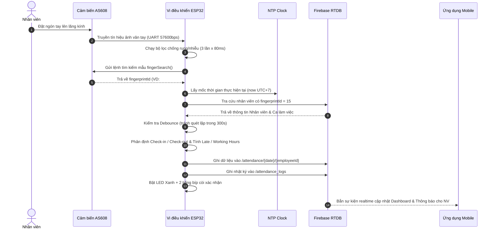
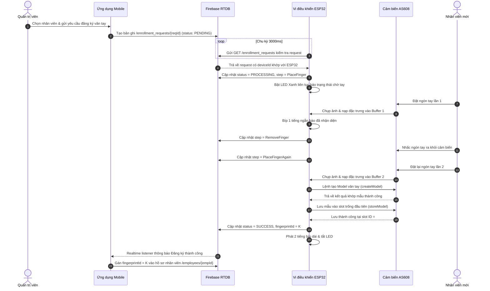

# BÁO CÁO ĐỒ ÁN TỐT NGHIỆP / NGHIÊN CỨU KỸ THUẬT
## HỆ THỐNG ĐIỂM DANH THÔNG MINH SỬ DỤNG VÂN TAY (ESP32 + AS608) VÀ ỨNG DỤNG DI ĐỘNG (REACT NATIVE + FIREBASE)

---

# CHƯƠNG 3: PHÂN TÍCH VÀ THIẾT KẾ HỆ THỐNG

## 3.1. Phân tích và thiết kế tổng thể

### 3.1.1. Phân tích yêu cầu chức năng

Hệ thống điểm danh thông minh Smart Attendance được xây dựng nhằm mục tiêu tự động hóa hoàn toàn quy trình chấm công, giảm thiểu gian lận, tối ưu hóa công tác quản trị nhân sự và cung cấp thông tin minh bạch tức thời cho nhân viên. Dựa trên phân hệ người dùng và thành phần kiến trúc, các yêu cầu chức năng được phân loại như sau:

#### A. Phân hệ Thiết bị điểm danh (ESP32 & Cảm biến vân tay AS608)
1. **Thu nhận và nhận dạng vân tay (1:N Identification)**: Quét vân tay người dùng, trích xuất vector đặc trưng và đối sánh với cơ sở dữ liệu mẫu vân tay lưu trữ trong bộ nhớ flash của cảm biến AS608.
2. **Khử nhiễu quang học và chống quét ảo**: Thực hiện thuật toán đọc kiểm chứng nhiều lần liên tiếp (`kConfirmReads = 3` lần, giãn cách `kConfirmGapMs = 80ms`) để loại bỏ hoàn toàn các trường hợp nhiễu quang học hoặc chạm thoáng qua.
3. **Đồng bộ thời gian chuẩn xác qua mạng (NTP Time Synchronization)**: Kết nối tới các máy chủ NTP (`pool.ntp.org`, `time.google.com`, `time.cloudflare.com`) để lấy thời gian thực theo múi giờ Việt Nam (UTC+7).
4. **Xử lý nghiệp vụ chấm công tự động**:
   - Xác định ca làm việc tương ứng của nhân viên trong ngày.
   - Nhận diện lượt quét đầu tiên trong ngày là **Vào ca (Check-in)** và các lượt quét tiếp theo là **Ra ca (Check-out)**.
   - Tính toán trạng thái Đúng giờ (`on_time`) hoặc Đi muộn (`late`) dựa trên ngưỡng thời gian ân hạn (`gracePeriodMinutes`, mặc định 10 phút).
   - Tính toán chính xác thời gian làm việc thực tế (`workingHours`) và giờ làm thêm tăng ca (`overtimeHours`).
   - Xử lý các ca làm việc đặc thù xuyên đêm (Overnight Shift, ví dụ 22:00 – 06:00 sáng hôm sau).
   - Cơ chế Debounce: Bỏ qua các lượt quét lặp lại trong vòng 300 giây (`DUPLICATE_WINDOW_SEC = 300`) sau lần quét hợp lệ gần nhất.
5. **Ghi nhận dữ liệu chấm công lên Cloud**: Sử dụng giao thức HTTPS REST client gửi dữ liệu chấm công đã chuẩn hóa trực tiếp lên node `/attendance/{date}/{employeeId}` và ghi nhật ký thô vào `/attendance_logs`.
6. **Đăng ký mẫu vân tay mới từ xa (Remote Fingerprint Enrollment)**: Định kỳ quét node `/enrollment_requests` trên Firebase. Khi phát hiện yêu cầu trạng thái `PENDING` gán cho thiết bị, ESP32 chuyển sang trạng thái `PROCESSING`, hướng dẫn người dùng quét vân tay 2 lần, tạo model và lưu vào slot trống đầu tiên của cảm biến, sau đó cập nhật kết quả `SUCCESS` kèm `fingerprintId` thật về Firebase.
7. **Tự động đồng bộ và dọn dẹp vân tay mồ côi (`syncDeletedFingerprints`)**: Đối chiếu danh sách `fingerprintId` đang có trên cảm biến với danh sách nhân viên hiệu lực trên Firebase `/employees`. Tự động xóa sạch các mẫu vân tay của nhân viên đã bị xóa khỏi hệ thống.
8. **Phản hồi người dùng tại chỗ (Local Feedback)**: Điều khiển LED chỉ thị 2 màu (Xanh/Đỏ) và còi Buzzer chủ động phát ra các tín hiệu âm thanh và ánh sáng tương ứng với từng trạng thái (Sẵn sàng, Đang quét, Thành công, Thất bại, Lỗi cảm biến).

#### B. Phân hệ Ứng dụng Quản trị viên (Admin Mobile App)
1. **Xác thực và phân quyền Quản trị**: Đăng nhập bằng Email/Password qua Firebase Authentication, kiểm tra quyền hạn `role === 'admin'` từ `/users/{uid}`.
2. **Bảng điều khiển tổng quan (Dashboard)**: Thống kê số lượng nhân sự, số người có mặt hôm nay, số lượt đúng giờ, số lượt đi muộn, tỷ lệ đúng giờ; theo dõi trạng thái kết nối trực tuyến của thiết bị ESP32; danh sách điểm danh thời gian thực.
3. **Quản lý danh sách nhân viên**: Thêm mới, chỉnh sửa thông tin nhân viên, khóa/kích hoạt tài khoản, gán ca làm việc, lọc theo phòng ban, tìm kiếm theo tên hoặc mã nhân viên.
4. **Tạo tài khoản nhân viên an toàn**: Sử dụng Firebase Secondary App Instance để khởi tạo tài khoản đăng nhập cho nhân viên mới mà không làm đăng xuất phiên làm việc của Quản trị viên.
5. **Quản lý ca làm việc**: Thêm, sửa, xóa các ca làm việc trong doanh nghiệp, cấu hình giờ bắt đầu, giờ kết thúc, thời gian ân hạn cho phép đi trễ.
6. **Khởi tạo quy trình đăng ký vân tay**: Chọn nhân viên và thiết bị điểm danh, gửi yêu cầu tạo mẫu vân tay lên Firebase để ESP32 tiếp nhận xử lý.
7. **Theo dõi và lọc lịch sử chấm công**: Xem chi tiết lịch sử vào/ra ca, lọc linh hoạt theo ngày, theo phòng ban và theo trạng thái (Đúng giờ / Đi muộn).
8. **Báo cáo và thống kê hiệu suất**: Hiển thị 4 chỉ số tổng hợp (Tỷ lệ đúng giờ, Tổng phút đi muộn, Tổng giờ làm việc, Tổng giờ tăng ca); bảng phân tích hiệu suất theo từng phòng ban; xuất dữ liệu báo cáo ra file CSV (chuẩn UTF-8 BOM tiếng Việt).

#### C. Phân hệ Ứng dụng Nhân viên (Employee Mobile App)
1. **Đăng nhập và phân quyền Nhân viên**: Nhận diện tài khoản có `role === 'employee'` và chuyển thẳng vào giao diện cá nhân.
2. **Dashboard cá nhân**: Hiển thị thông tin cá nhân, avatar, ca làm việc hôm nay, huy hiệu trạng thái làm việc thời gian thực (*Đang làm việc* / *Đã ra về* / *Chưa có dữ liệu*).
3. **Thông báo chấm công Realtime**: Tự động lắng nghe thay đổi dữ liệu chấm công từ Firebase và hiển thị thông báo popup ngay khi nhân viên vừa quét vân tay thành công tại thiết bị.
4. **Xem lịch sử chấm công cá nhân**: Bộ lọc linh hoạt xem theo: Hôm nay (`TODAY`), Tuần này (`WEEK`), Tháng này (`MONTH`) hoặc Tất cả (`ALL`).
5. **Theo dõi lịch ca làm việc**: Hiển thị thông tin chi tiết ca làm việc được phân công, tự động highlight ca làm việc của ngày hiện tại.
6. **Quản lý tài khoản cá nhân**: Cập nhật ảnh đại diện (lưu trữ Firebase Storage / Cloud), đổi mật khẩu cá nhân an toàn (xác thực lại mật khẩu cũ trước khi cập nhật).

---

### 3.1.2. Phân tích yêu cầu phi chức năng

1. **Độ chính xác sinh trắc học (Biometric Accuracy)**:
   - Tỷ lệ từ chối sai (False Rejection Rate - FRR): $\le 1.0\%$.
   - Tỷ lệ chấp nhận sai (False Acceptance Rate - FAR): $\le 0.001\%$.
   - Mức độ bảo mật cảm biến: Đạt tiêu chuẩn bảo mật vân tay cấp độ 3 (Security Level 3 của AS608).
2. **Thời gian đáp ứng và hiệu năng (Response Time & Performance)**:
   - Thời gian quét và đối sánh vân tay tại cảm biến: $< 0.8 \text{ giây}$.
   - Thời gian xử lý nghiệp vụ và phản hồi LED/Buzzer: $< 1.0 \text{ giây}$.
   - Thời gian đồng bộ dữ liệu từ ESP32 lên Firebase RTDB qua HTTPS: $< 1.5 \text{ giây}$ (trong điều kiện mạng WiFi tiêu chuẩn).
   - Thời gian ứng dụng di động nhận cập nhật qua Realtime Listener: $< 0.5 \text{ giây}$ ngay sau khi Firebase nhận dữ liệu.
3. **Độ tin cậy và Khả năng chịu lỗi (Reliability & Fault Tolerance)**:
   - Cơ chế tự phục hồi kết nối WiFi (`WiFiService::ensureConnected`): Tự động phát hiện mất mạng và thực hiện tái kết nối sau mỗi chu kỳ chờ.
   - Cơ chế thử lại giao tiếp mạng (`NETWORK_RETRIES = 3`): Tự động gửi lại request chấm công tối đa 3 lần nếu gặp lỗi kết nối tạm thời.
   - Cơ chế giải cứu yêu cầu đăng ký treo (`recoverStaleRequests`): Khi ESP32 khởi động lại, các request bị kẹt ở trạng thái `PROCESSING` từ phiên trước sẽ tự động chuyển thành `FAILED` để tránh treo tiến trình của ứng dụng.
4. **Tính an toàn và bảo mật thông tin (Security)**:
   - Toàn bộ giao tiếp giữa ESP32, Ứng dụng di động và Firebase đều chạy trên giao thức mã hóa **TLS/HTTPS**.
   - Phân quyền nghiêm ngặt dựa trên vai trò lưu trữ tại node bảo mật `/users/{uid}/role`, tuyệt đối không hard-code kiểm tra chuỗi email.
   - Tài khoản bị vô hiệu hóa (`active: false`) sẽ ngay lập tức bị từ chối đăng nhập và hủy phiên làm việc.
5. **Khả năng tương thích và di động (Portability & UX)**:
   - Ứng dụng di động được đóng gói thành một file APK duy nhất (`com.smartattendance`), dung lượng tối ưu ~124.5 MB, hỗ trợ đầy đủ các kiến trúc vi xử lý Android (`arm64-v8a`, `armeabi-v7a`, `x86`, `x86_64`).
   - Nhúng sẵn bundle JavaScript offline, cho phép ứng dụng khởi động tức thì và hoạt động độc lập không phụ thuộc môi trường phát triển (Metro bundler).
   - Giao diện thiết kế theo chuẩn Mobile-First, tự động co giãn thích ứng (responsive) trên mọi kích thước màn hình từ 360dp trở lên.

---

### 3.1.3. Kiến trúc tổng thể hệ thống

Hệ thống Smart Attendance được xây dựng dựa trên mô hình kiến trúc phân tầng 3 lớp (3-Tier Architecture) kết hợp mô hình điều khiển theo sự kiện (Event-Driven Architecture):

```mermaid
graph TD
    subgraph "1. Tầng Thiết bị Cạnh (Edge Device Layer)"
        AS608["Cảm biến vân tay quang học AS608"] <-->|UART 57600bps| ESP32["Vi điều khiển ESP32 (NodeMCU)"]
        ESP32 -->|GPIO 18 / 19| LED["LED kép Xanh / Đỏ"]
        ESP32 -->|GPIO 4| Buzzer["Còi Buzzer báo hiệu"]
        NTP["Máy chủ thời gian NTP Server (UTC+7)"] -.->|UDP 123| ESP32
    end

    subgraph "2. Tầng Dịch vụ Đám mây (Cloud Layer - Firebase)"
        FB_AUTH["Firebase Authentication\n(Xác thực tài khoản)"]
        FB_RTDB["Firebase Realtime Database\n- /users\n- /employees\n- /shifts\n- /attendance\n- /enrollment_requests\n- /devices"]
        FB_STORE["Firebase Cloud Storage\n(Lưu trữ ảnh đại diện)"]
    end

    subgraph "3. Tầng Ứng dụng Di động (Mobile App Layer - React Native)"
        AdminUI["Giao diện Quản trị viên (Admin)\n- Dashboard\n- Nhân viên & Ca làm\n- Lịch sử & Báo cáo"]
        EmpUI["Giao diện Nhân viên (Employee)\n- Dashboard cá nhân\n- Lịch sử chấm công\n- Thông tin & Ca làm"]
    end

    ESP32 <==>|HTTPS REST API / JSON| FB_RTDB
    AdminUI <==>|Firebase SDK (Auth + Realtime Listeners)| FB_AUTH
    AdminUI <==>|WebSocket / SSL| FB_RTDB
    EmpUI <==>|Firebase SDK| FB_AUTH
    EmpUI <==>|WebSocket / SSL| FB_RTDB
    EmpUI <==>|HTTPS Upload/Download| FB_STORE
```

1. **Tầng Thiết bị Cạnh (Edge Device Layer)**:
   - Vi điều khiển trung tâm ESP32 đóng vai trò bộ xử lý biên. ESP32 kết nối với cảm biến quang học AS608 thông qua bộ UART phần cứng thứ 2 (`HardwareSerial(2)`), đảm nhận nhiệm vụ thu nhận ảnh vân tay, đối sánh mẫu và điều khiển thiết bị ngoại vi (LED, Buzzer).
   - Thiết bị đồng bộ thời gian độc lập với Internet thông qua giao thức NTP, loại bỏ sự phụ thuộc vào module đồng hồ phần cứng RTC (DS3231).
2. **Tầng Dịch vụ Đám mây (Cloud Services Layer)**:
   - Sử dụng nền tảng Google Firebase làm backend trung tâm dạng Serverless.
   - **Firebase Authentication**: Quản lý định danh người dùng qua cặp Email/Password an toàn.
   - **Firebase Realtime Database (RTDB)**: Cơ sở dữ liệu hướng tài liệu NoSQL với cây dữ liệu JSON phân cấp, cung cấp tính năng đồng bộ thời gian thực thông qua kết nối WebSocket bảo mật hai chiều.
   - **Firebase Storage**: Lưu trữ hình ảnh đại diện người dùng dạng nhị phân.
3. **Tầng Ứng dụng Di động (Mobile Application Layer)**:
   - Ứng dụng Android xây dựng bằng framework React Native (TypeScript).
   - Sử dụng kiến trúc Single Package / Single APK với cơ chế điều hướng rẽ nhánh động (Dynamic Role Routing), cho phép Quản trị viên và Nhân viên cùng sử dụng chung một ứng dụng cài đặt duy nhất.

---

### 3.1.4. Luồng hoạt động và trao đổi dữ liệu

#### A. Luồng nghiệp vụ Điểm danh (Attendance Workflow)



*Quy tắc tính toán thời gian trong `AttendanceCalculator`:*
- **Xác định ngày của ca làm việc (`shiftDayFor`)**: Đối với ca làm việc bình thường, ngày làm việc là ngày hiện tại. Đối với ca làm việc xuyên đêm (ví dụ: bắt đầu lúc 22:00 hôm trước và kết thúc lúc 06:00 sáng hôm sau), các lượt quét sau nửa đêm nhưng trước thời điểm `06:00 + OVERNIGHT_CARRY_MINUTES (360 phút = 12:00 trưa)` vẫn được tính thuộc về ca làm việc của ngày hôm trước.
- **Tính toán trạng thái Đi muộn (`isLate`)**:
  $$\text{lateMinutes} = \max\left(0, \left\lfloor \frac{t_{\text{checkIn}} - t_{\text{shiftStart}}}{60} \right\rfloor\right)$$
  Nếu $\text{lateMinutes} \ge \text{gracePeriodMinutes}$ thì `status = "late"`, ngược lại `status = "on_time"`.
- **Tính toán giờ làm việc (`workingHours`) và giờ tăng ca (`overtimeHours`)**:
  $$\text{workingMinutes} = \max\left(0, \left\lfloor \frac{t_{\text{checkOut}} - t_{\text{checkIn}}}{60} \right\rfloor\right)$$
  $$\text{workingHours} = \text{round}\left(\frac{\text{workingMinutes}}{60}, 2\right)$$
  Nếu $t_{\text{checkOut}} > t_{\text{shiftEnd}}$:
  $$\text{overtimeMinutes} = \max\left(0, \left\lfloor \frac{t_{\text{checkOut}} - t_{\text{shiftEnd}}}{60} \right\rfloor\right)$$
  $$\text{overtimeHours} = \text{round}\left(\frac{\text{overtimeMinutes}}{60}, 2\right)$$

#### B. Luồng nghiệp vụ Đăng ký vân tay từ xa (Enrollment Workflow)



---

## 3.2. Thiết kế phần cứng và thiết bị điểm danh

### 3.2.1. Thiết kế phần cứng ESP32

Thiết bị điểm danh sử dụng vi điều khiển **ESP32 NodeMCU-32S** (chíp ESP-WROOM-32). Các thông số kỹ thuật chính:
- **Vi xử lý**: Xtensa Dual-Core 32-bit LX6, xung nhịp 240 MHz, năng lực tính toán đạt 600 DMIPS.
- **Bộ nhớ**: 520 KB SRAM nội, 4 MB Flash SPI gắn ngoài.
- **Kết nối không dây**: Wi-Fi 802.11 b/g/n (tốc độ lên tới 150 Mbps), hỗ trợ cơ chế bảo mật WPA/WPA2 Personal.
- **Ngoại vi giao tiếp**: 3 bộ phần cứng UART (`UART0`, `UART1`, `UART2`). Thiết kế sử dụng:
  - `UART0` (GPIO 1 - TX0, GPIO 3 - RX0): Dùng cho việc nạp code, debug qua Serial Monitor với máy tính (115200 bps).
  - `UART2` (GPIO 16 - RX2, GPIO 17 - TX2): Dùng để truyền nhận dữ liệu độc lập tốc độ cao với cảm biến vân tay AS608 (57600 bps).
- **Điện áp hoạt động**: 3.3V logic. Cấp nguồn ngoài qua cổng Micro-USB 5V/2A với mạch hạ áp tích hợp AMS1117-3.3V trên board.

---

### 3.2.2. Thiết kế kết nối ESP32 và AS608

Cảm biến vân tay quang học **AS608** là loại cảm biến sinh trắc học tích hợp chip xử lý DSP chuyên dụng, hỗ trợ giao tiếp nối tiếp tiêu chuẩn TTL. Cảm biến hoạt động ở dải điện áp 3.3V – 5.5V.

| Chân AS608 | Màu dây chuẩn | Chân ESP32 kết nối | Chức năng chi tiết |
| :--- | :--- | :--- | :--- |
| **VCC** | Đỏ (Red) | **VIN (5V) / 3.3V** | Nguồn cấp cho cảm biến và đèn LED quang học |
| **GND** | Đen (Black) | **GND** | Nối đất chung toàn hệ thống |
| **TXD** | Vàng (Yellow) | **GPIO 16 (RX2)** | Truyền dữ liệu nối tiếp từ AS608 sang chân nhận của ESP32 |
| **RXD** | Xanh lá (Green)| **GPIO 17 (TX2)** | Nhận lệnh điều khiển nối tiếp từ chân phát của ESP32 |
| **TOUCH (WAKE)** | Xanh dương | Không dùng (NC) | Chân báo ngắt chạm cảm ứng |
| **3.3V_OUT** | Trắng | Không dùng (NC) | Nguồn ra phụ của cảm biến |

*Cấu hình truyền thông nối tiếp trong mã nguồn (`FingerprintSensor.cpp`):*
```cpp
void FingerprintSensor::begin(uint32_t baud, int rxPin, int txPin, uint16_t fallbackCapacity) {
  _fallbackCapacity = fallbackCapacity;
  _serial.begin(baud, SERIAL_8N1, rxPin, txPin); // baud = 57600, rxPin = 16, txPin = 17
  delay(1000);  // Đợi cảm biến ổn định nguồn
}
```

---

### 3.2.3. Thiết kế kết nối LED và buzzer

Mạch phản hồi trực quan và âm thanh bao gồm 2 đèn LED hiển thị trạng thái và 1 còi Buzzer chủ động (Active Buzzer):

1. **LED Xanh (Green LED)**: Nối chân Anode với **GPIO 18** thông qua điện trở hạn dòng $220\,\Omega$, chân Cathode nối GND. Báo hiệu trạng thái chờ ngón tay, quét vân tay thành công hoặc hoàn thành một bước đăng ký.
2. **LED Đỏ (Red LED)**: Nối chân Anode với **GPIO 19** thông qua điện trở hạn dòng $220\,\Omega$, chân Cathode nối GND. Báo hiệu lỗi nhận diện, quét thất bại hoặc mất kết nối phần cứng với cảm biến.
3. **Còi Buzzer chủ động (Active Buzzer 5V)**: Chân dương nối với **GPIO 4**, chân âm nối GND. Còi tích hợp sẵn mạch dao động nội, phát ra âm thanh tần số khoảng 2.5 kHz khi GPIO 4 được kích hoạt mức cao (`HIGH`).

*Bảng trạng thái phản hồi của bộ chỉ thị (`Indicator.cpp`):*

| Sự kiện / Trạng thái | LED Xanh (GPIO 18) | LED Đỏ (GPIO 19) | Còi Buzzer (GPIO 4) | Ý nghĩa thực tế |
| :--- | :---: | :---: | :---: | :--- |
| **Sẵn sàng (Ready)** | Tắt | Tắt | 1 bíp ngắn (60ms) | Khởi động xong, hệ thống sẵn sàng |
| **Đang xử lý (Busy)** | Bật liên tục | Tắt | Tắt | Đang đợi người dùng đặt ngón tay |
| **Đã đọc tay (Read)** | Bật | Tắt | 1 bíp ngắn (80ms) | Cảm biến đã chụp xong ảnh vân tay |
| **Thành công (Success)** | Bật trong 1s | Tắt | 2 bíp ngắn (100ms) | Chấm công / Đăng ký thành công |
| **Thất bại (Failure)** | Tắt | Bật trong 1s | 1 bíp dài (700ms) | Không khớp vân tay / Đã chấm công rồi |
| **Lỗi cảm biến (Error)**| Tắt | Bật liên tục | Tắt | Lỗi dây kết nối UART hoặc hỏng sensor |

---

### 3.2.4. Thiết kế chức năng đăng ký và xác thực vân tay

#### A. Thuật toán tìm kiếm slot bộ nhớ trống (`findFreeSlot`)
Bộ nhớ cảm biến AS608 chia thành các vị trí lưu (slot ID từ 1 đến `capacity`). Trước khi ghi vân tay mới, hệ thống tự động dò tìm vị trí đầu tiên chưa có dữ liệu:
```cpp
int FingerprintSensor::findFreeSlot() {
  if (_finger.getParameters() != FINGERPRINT_OK) return kSlotCommError;
  const uint16_t cap = capacity();
  for (uint16_t id = 1; id < cap; id++) {
    const uint8_t p = _finger.loadModel(id);
    if (p == FINGERPRINT_OK) continue; // Slot đã có vân tay
    if (p == FINGERPRINT_PACKETRECIEVEERR) return kSlotCommError;
    return id; // Tìm thấy slot trống đầu tiên
  }
  return kSlotFull;
}
```

#### B. Thuật toán đăng ký 2 bước và ghép mẫu (`enroll`)
Để tạo một mẫu vân tay chuẩn (Fingerprint Template), cảm biến yêu cầu quét ngón tay 2 lần để đối sánh độ trùng khớp, loại trừ trường hợp ngón tay bị lệch hoặc tiếp xúc kém:
1. `captureToBuffer(1, timeout)`: Chụp ảnh lần 1, chuyển đổi thành file đặc trưng lưu tại Character Buffer 1 (`image2Tz(1)`).
2. `waitForRemoval(timeout)`: Buộc người dùng phải nhấc ngón tay ra khỏi lăng kính để tránh quét trùng 1 ảnh.
3. `captureToBuffer(2, timeout)`: Chụp ảnh lần 2 khi người dùng đặt lại tay, chuyển đổi đặc trưng vào Character Buffer 2 (`image2Tz(2)`).
4. `createModel()`: Thuật toán DSP của cảm biến đối chiếu đặc trưng ở Buffer 1 và Buffer 2. Nếu độ tương đồng đạt chuẩn, ghép thành một file mẫu tổng hợp (Model).
5. `storeModel(slot)`: Ghi file mẫu vào bộ nhớ flash tại slot ID đã tìm được.

#### C. Thuật toán nhận dạng và lọc nhiễu quang học (`search`)
Để tránh hiện tượng ánh sáng môi trường thay đổi đột ngột hoặc ngón tay quẹt ngang qua kích hoạt sai, hệ thống thiết kế cơ chế lọc ngón tay thật:
```cpp
int FingerprintSensor::search() {
  if (_finger.getImage() != FINGERPRINT_OK) return -1; // Không có tay
  // Xác nhận ngón tay thật bằng cách kiểm tra liên tiếp kConfirmReads lần
  for (uint8_t i = 0; i < kConfirmReads; i++) {
    delay(kConfirmGapMs);
    if (_finger.getImage() != FINGERPRINT_OK) return -1; // Nhiễu thoáng qua -> bỏ qua
  }
  if (_finger.image2Tz(1) != FINGERPRINT_OK) return -2; // Ảnh quá mờ
  const uint8_t p = _finger.fingerSearch();
  if (p == FINGERPRINT_OK) return _finger.fingerID; // Khớp thành công, trả về ID
  if (p == FINGERPRINT_NOTFOUND) return -3;         // Vân tay lạ chưa đăng ký
  return -4;                                        // Lỗi gói tin truyền thông
}
```

---

## 3.3. Thiết kế cơ sở dữ liệu và ứng dụng Mobile

### 3.3.1. Thiết kế cơ sở dữ liệu Firebase

Hệ thống sử dụng cơ sở dữ liệu phi quan hệ Firebase Realtime Database. Cây dữ liệu JSON được tổ chức khoa học, phân chia theo từng nghiệp vụ độc lập:

```json
{
  "users": {
    "{uid}": {
      "email": "admin@smartattendance.com",
      "role": "admin",
      "active": true,
      "employeeId": "NV001",
      "createdAt": "2026-09-13T08:00:00.000Z"
    }
  },
  "employees": {
    "NV001": {
      "employeeId": "NV001",
      "name": "Nguyễn Văn A",
      "department": "Kỹ thuật",
      "position": "Kỹ sư nhúng",
      "email": "nva@smartattendance.com",
      "phone": "0987654321",
      "fingerprintId": 15,
      "assignedShiftId": "SHIFT_HC",
      "active": true,
      "avatarUrl": "https://..."
    }
  },
  "shifts": {
    "SHIFT_HC": {
      "shiftId": "SHIFT_HC",
      "shiftName": "Ca Hành chính",
      "startTime": "08:00",
      "endTime": "17:00",
      "gracePeriodMinutes": 15,
      "active": true
    },
    "SHIFT_DEM": {
      "shiftId": "SHIFT_DEM",
      "shiftName": "Ca Đêm",
      "startTime": "22:00",
      "endTime": "06:00",
      "gracePeriodMinutes": 10,
      "active": true
    }
  },
  "attendance": {
    "2026-09-23": {
      "NV001": {
        "employeeId": "NV001",
        "checkIn": "08:05:22",
        "checkOut": "17:35:10",
        "status": "on_time",
        "lateMinutes": 0,
        "earlyMinutes": 0,
        "workingHours": 9.5,
        "overtimeHours": 0.58,
        "shiftId": "SHIFT_HC",
        "deviceId": "esp32_001"
      }
    }
  },
  "attendance_logs": {
    "-O7xyz123456": {
      "deviceId": "esp32_001",
      "employeeId": "NV001",
      "fingerprintId": 15,
      "outcome": "CheckedIn",
      "timestamp": "2026-09-23T08:05:22+07:00"
    }
  },
  "enrollment_requests": {
    "req_1727000000": {
      "requestId": "req_1727000000",
      "employeeId": "NV002",
      "deviceId": "esp32_001",
      "status": "SUCCESS",
      "fingerprintId": 16,
      "step": "FingerCaptured",
      "createdAt": "2026-09-23T09:10:00.000Z",
      "updatedAt": "2026-09-23T09:10:25.000Z"
    }
  },
  "devices": {
    "esp32_001": {
      "deviceId": "esp32_001",
      "name": "Thiết bị Cửa chính",
      "location": "Văn phòng Tầng 1",
      "status": "ONLINE",
      "lastSeen": "2026-09-28T08:25:00+07:00",
      "capacity": 127,
      "storedTemplates": 28
    }
  },
  "settings": {
    "companyName": "Công ty TNHH Smart Attendance",
    "wifiSsidDefault": "Thinh",
    "graceMinutesGlobal": 10
  }
}
```

---

### 3.3.2. Thiết kế kiến trúc ứng dụng Mobile

Ứng dụng di động được xây dựng trên nền tảng **React Native 0.87.1** sử dụng ngôn ngữ **TypeScript**. Cấu trúc mã nguồn tuân thủ nguyên tắc phân tách mối quan tâm (Separation of Concerns):

```
C:\Project_ST2
├── android/                   # Dự án native Android (Gradle, Manifest, Assets)
├── src/
│   ├── components/            # UI Components tái sử dụng
│   │   ├── common/            # Badge, Button, Input, StatCard, Header, BottomTabBar
│   │   ├── employees/         # EmployeeCard, EmployeeModal
│   │   ├── enrollment/        # EnrollmentModal
│   │   └── shifts/            # ShiftCard, ShiftModal
│   ├── config/                # Cấu hình Firebase App (API Key, Project ID, DB URL)
│   ├── constants/             # Bảng màu COLORS, đường dẫn PATHS, AUTH
│   ├── navigation/            # NavigationContext quản lý tab và chuyển màn hình
│   ├── screens/               # Màn hình chức năng Quản trị
│   │   ├── employee/          # Phân hệ màn hình riêng cho Nhân viên (Dashboard, History, Profile, Shifts)
│   │   ├── AttendanceHistoryScreen.tsx
│   │   ├── DashboardScreen.tsx
│   │   ├── EmployeesScreen.tsx
│   │   ├── LoginScreen.tsx
│   │   ├── MainAppScreen.tsx
│   │   ├── ReportsScreen.tsx
│   │   └── ShiftsScreen.tsx
│   ├── services/firebase/     # Tầng giao tiếp Firebase (Auth, RTDB, AdminAuth)
│   ├── types/                 # Định nghĩa kiểu dữ liệu TypeScript
│   └── utils/                 # Hàm tiện ích (DateUtils, Validators, Mappers, ExportUtils)
├── App.tsx                    # Root Component điều hướng theo quyền role
└── index.js                   # Điểm khởi chạy ứng dụng
```

*Cơ chế hợp nhất 2 ứng dụng thành 1 APK duy nhất (`App.tsx`):*
```tsx
export default function App() {
  const [currentUser, setCurrentUser] = useState<User | null>(null);
  const [authLoading, setAuthLoading] = useState(true);

  useEffect(() => {
    return subscribeToAuthState(state => {
      setCurrentUser(state.user);
      setAuthLoading(false);
    });
  }, []);

  return (
    <SafeAreaProvider>
      <NavigationProvider>
        {currentUser ? (
          currentUser.role === 'admin' ? (
            <MainAppScreen user={currentUser} />
          ) : (
            <EmployeeAppScreen user={currentUser} />
          )
        ) : (
          <LoginScreen />
        )}
      </NavigationProvider>
    </SafeAreaProvider>
  );
}
```

---

### 3.3.3. Thiết kế kết nối ứng dụng với Firebase

- **Khởi tạo kết nối (`src/config/firebase.ts`)**: Sử dụng Firebase JS SDK phiên bản 12 kết nối trực tiếp đến project `hihihaha-6f707`.
- **Tạo tài khoản nhân viên không mất session (`adminAuthService.ts`)**: Khi Admin tạo nhân viên mới, nếu dùng hàm `createUserWithEmailAndPassword()` thông thường thì SDK sẽ tự động đăng nhập vào tài khoản mới và đá Admin văng ra ngoài. Giải pháp là khởi tạo một `Secondary Firebase App Instance`:
```typescript
const secondaryApp = initializeApp(firebaseConfig, 'SecondaryAdminApp');
const secondaryAuth = getAuth(secondaryApp);
// Tạo tài khoản nhân viên trên secondaryAuth -> phiên làm việc của Admin trên primary app hoàn toàn được bảo toàn!
```

---

### 3.3.4. Thiết kế cơ chế đồng bộ dữ liệu

1. **Lắng nghe thời gian thực hai chiều (Realtime Listeners)**: Các màn hình Dashboard và Danh sách chấm công sử dụng hàm `onValue(ref(...), callback)` của Firebase Realtime Database. Bất kỳ khi nào ESP32 đẩy bản ghi chấm công lên node `/attendance`, giao diện điện thoại của cả Admin và Nhân viên lập tức kích hoạt cập nhật lại State và render giao diện trong thời gian dưới 500ms mà không cần người dùng kéo vuốt tải lại.
2. **Đồng bộ dọn dẹp vân tay mồ côi (`syncDeletedFingerprints`)**: Khi Quản trị viên xóa một nhân viên trên ứng dụng di động, dữ liệu tại node `/employees/{employeeId}` bị xóa. Khi ESP32 khởi động hoặc chạy chu kỳ kiểm tra, nó đối chiếu danh sách các ID còn tồn tại trên Firebase với các slot đang lưu trên AS608. Bất kỳ slot nào trên cảm biến mà không tìm thấy nhân viên tương ứng trên Firebase sẽ được lệnh `sensor.deleteTemplate(id)` tự động xóa sạch, đảm bảo không bị rác bộ nhớ và ngăn ngừa nguy cơ nhân viên cũ đã nghỉ việc vẫn chấm công được.

---

## 3.4. Thiết kế giao diện và chức năng ứng dụng Mobile

### 3.4.1. Thiết kế giao diện đăng nhập và Dashboard

1. **Giao diện Đăng nhập (`LoginScreen`)**:
   - Giao diện Dark Theme hiện đại (`COLORS.slate900`), hiển thị logo thương hiệu Smart Attendance.
   - Form nhập Email và Mật khẩu với cơ chế xử lý lỗi chuẩn xác (sai mật khẩu, tài khoản không tồn tại, tài khoản bị khóa).
   - Nút đăng nhập tích hợp trạng thái xoay vòng `ActivityIndicator`.
2. **Giao diện Admin Dashboard (`DashboardScreen`)**:
   - Thanh trạng thái hiển thị thiết bị ESP32 (Đèn xanh ONLINE/Đèn xám OFFLINE).
   - Grid 4 thẻ thống kê nhanh: Tổng nhân sự, Có mặt hôm nay, Điểm danh đúng giờ, Đi muộn.
   - Các nút tác vụ nhanh (Quick Actions): Chuyển nhanh sang Quản lý nhân viên, Quản lý ca làm, Đăng ký vân tay.
   - Danh sách lượt điểm danh gần nhất (Recent Activity) cập nhật tức thời theo thời gian thực.
3. **Giao diện Employee Dashboard (`EmployeeDashboardScreen`)**:
   - Lời chào cá nhân hóa theo buổi (Chào buổi sáng / Buổi chiều), hiển thị ảnh đại diện và chức vụ.
   - Huy hiệu trạng thái làm việc to bản, trực quan (*Đang làm việc* màu xanh ngọc, *Đã ra về* màu chàm).
   - Card ca làm việc hôm nay (Giờ vào ca, Giờ tan ca, Thời gian ân hạn).
   - Modal Popup thông báo kết quả chấm công hiển thị tự động khi có lượt quét vân tay mới từ cảm biến.

---

### 3.4.2. Thiết kế chức năng quản lý người dùng

1. **Danh sách nhân viên (`EmployeesScreen`)**:
   - Hiển thị danh sách nhân viên dạng thẻ (Card list) với avatar, tên, mã NV, phòng ban, chức vụ, trạng thái kích hoạt và huy hiệu vân tay (Đã có vân tay #ID / Chưa có vân tay).
   - Thanh tìm kiếm thông minh theo Tên, Mã NV, Số điện thoại.
   - Bộ lọc phòng ban linh hoạt (Tất cả, Kỹ thuật, Kinh doanh, Nhân sự, Kế toán,...).
2. **Modal Thêm / Sửa nhân viên (`EmployeeModal`)**:
   - Nhập đầy đủ thông tin: Họ tên, Email, Mật khẩu khởi tạo, Số điện thoại, Phòng ban, Chức vụ, Ca làm việc phân công.
   - Nút gạt bật/tắt trạng thái kích hoạt tài khoản (`active`).
3. **Modal Đăng ký vân tay (`EnrollmentModal`)**:
   - Cho phép Quản trị viên chọn thiết bị ESP32 thực hiện quét.
   - Hiển thị tiến trình trực quan 4 bước: *Khởi tạo yêu cầu* $\rightarrow$ *Chờ đặt ngón tay lần 1* $\rightarrow$ *Nhấc tay ra* $\rightarrow$ *Đặt lại ngón tay lần 2* $\rightarrow$ *Hoàn thành*.

---

### 3.4.3. Thiết kế chức năng quản lý và theo dõi điểm danh

1. **Lịch sử chấm công toàn cơ quan (`AttendanceHistoryScreen`)**:
   - Bộ chọn ngày chấm công (mặc định là ngày hôm nay).
   - Bộ lọc trạng thái: Tất cả (`ALL`), Đúng giờ (`ON_TIME`), Đi muộn (`LATE`).
   - Hiển thị thẻ chấm công chi tiết: Tên nhân viên, giờ Check-in, giờ Check-out, số phút đi muộn, tổng giờ làm việc thực tế, số giờ làm thêm (OT).
2. **Quản lý ca làm việc (`ShiftsScreen`)**:
   - Danh sách ca làm việc hiện hành trong hệ thống.
   - Cấu hình linh hoạt: Giờ bắt đầu, Giờ kết thúc, Thời gian ân hạn (`gracePeriodMinutes`).
   - Tự động nhận diện và gán nhãn đối với các ca làm việc xuyên đêm (Overnight shift).

---

### 3.4.4. Thiết kế chức năng thống kê và quản lý dữ liệu

1. **Màn hình Báo cáo & Thống kê (`ReportsScreen`)**:
   - Thiết kế 4 ô thống kê chủ chốt bố trí theo 2 hàng ngang cân đối hoàn hảo:
     - **TỶ LỆ ĐÚNG GIỜ**: Tính theo phần trăm lượt đúng giờ trên tổng lượt chấm công thực tế, kèm dòng mô tả tỷ lệ số lượt (`x / y lượt đúng giờ`).
     - **TỔNG PHÚT ĐI MUỘN**: Tổng hợp chính xác số phút đi muộn từ tất cả các lượt chấm công có trạng thái muộn, kèm số lượt vi phạm.
     - **TỔNG GIỜ LÀM**: Tổng thời gian làm việc thực tế của toàn bộ hệ thống tính bằng giờ (làm tròn 1 chữ số thập phân).
     - **TỔNG GIỜ TĂNG CA**: Tổng số giờ làm việc ngoài giờ chuẩn của nhân viên.
   - Bảng phân tích **Hiệu suất theo phòng ban**: Bảng dữ liệu thống kê chi tiết theo từng đơn vị phòng ban gồm 4 cột: Phòng ban, Tổng số lượt chấm công, Tỷ lệ đúng giờ (%), Tổng giờ làm việc (h).
2. **Xuất báo cáo dữ liệu (Export Data)**:
   - Module `exportUtils.ts` chuyển đổi dữ liệu chấm công sang định dạng bảng tính CSV.
   - Thêm mã định danh ký tự UTF-8 BOM (`\uFEFF`) ở đầu tệp tin, giúp mở file trực tiếp trên Microsoft Excel tiếng Việt không bị lỗi font chữ.
   - Tích hợp tính năng chia sẻ tệp (Action Share) gửi file báo cáo qua Email, Zalo, Google Drive hoặc lưu trữ nội bộ trên điện thoại.

---
---

# CHƯƠNG 4: XÂY DỰNG, TÍCH HỢP VÀ KIỂM THỬ HỆ THỐNG

## 4.1. Xây dựng hệ thống phần cứng

### 4.1.1. Lắp ráp ESP32 và AS608

Quá trình lắp ráp phần cứng được tiến hành trên bo mạch thử nghiệm (Breadboard) và cố định chắc chắn trên hộp mô hình thiết bị:
1. **Kiểm tra nguồn cấp**: Cảm biến AS608 tiêu thụ dòng đỉnh lên tới $120\text{ mA}$ trong quá trình kích hoạt đèn LED quang học để quét ảnh. Do đó, chân VCC của AS608 được cấp trực tiếp từ nguồn $5\text{V}$ (chân VIN của ESP32 khi cắm USB) để đảm bảo độ nhạy quang học cao nhất và tránh hiện tượng sụt áp làm reset ESP32.
2. **Đấu nối tín hiệu UART**:
   - Chân TX của AS608 nối vào chân GPIO 16 (RX2) của ESP32.
   - Chân RX của AS608 nối vào chân GPIO 17 (TX2) của ESP32.
   - Chân GND của cảm biến nối với chân GND của ESP32.
3. **Cố định cơ khí**: Lăng kính thu nhận vân tay của AS608 được đặt ở mặt trên của vỏ hộp với góc nghiêng $15^\circ$ thuận tiện cho người dùng đặt ngón tay tự nhiên.

---

### 4.1.2. Kết nối LED và buzzer

1. **Lắp ráp LED chỉ thị**:
   - LED xanh lá và LED đỏ được gắn xuyên qua mặt trước của vỏ hộp.
   - Chân dương (Anode - chân dài) của LED xanh nối tiếp điện trở $220\,\Omega$ về chân GPIO 18 của ESP32.
   - Chân dương (Anode - chân dài) của LED đỏ nối tiếp điện trở $220\,\Omega$ về chân GPIO 19 của ESP32.
   - Chân âm (Cathode - chân ngắn) của cả 2 LED được nối chung về đường GND.
2. **Lắp ráp còi Buzzer**:
   - Sử dụng còi Buzzer 5V chủ động loại nhỏ (đường kính 9mm).
   - Chân cực dương $(+)$ của còi nối với GPIO 4 của ESP32.
   - Chân cực âm $(-)$ của còi nối trực tiếp về GND.

---

### 4.1.3. Lập trình ESP32

Mã nguồn ESP32 được cấu trúc theo mô hình phân tầng hướng đối tượng bằng C++ trên nền tảng Arduino core for ESP32:
- **`Indicator`**: Đóng gói các hàm điều khiển chuỗi nhấp nháy LED và độ trễ tiếng bíp còi báo hiệu (`showReady()`, `showBusy()`, `showSuccess()`, `showFailure()`, `showSensorError()`).
- **`WiFiService`**: Đảm bảo kết nối mạng WiFi luôn thông suốt, tự động thử lại khi mất sóng với timeout cấu hình trong `Settings`.
- **`NtpClock`**: Sử dụng thư viện hệ thống `esp_sntp`, đồng bộ giờ mạng theo chuẩn UTC+7 với máy chủ quốc tế, cung cấp các hàm lấy ngày tháng dạng chuỗi `YYYY-MM-DD` và giờ dạng `HH:MM:SS`.
- **`FirebaseREST`**: Lớp tiện ích đóng gói giao thức HTTPS client, hỗ trợ các phương thức `GET`, `PUT`, `POST`, `PATCH`, `DELETE` với máy chủ Firebase Realtime Database thông qua URL có đuôi `.json`.
- **`FingerprintSensor`**: Lớp bọc cấp cao (wrapper) điều khiển cảm biến AS608 dựa trên thư viện chuẩn `Adafruit_Fingerprint`, quản lý bộ UART2 tốc độ 57600 bps.
- **`EnrollmentService` & `AttendanceService`**: Đảm nhiệm toàn bộ logic nghiệp vụ điều phối giữa cảm biến phần cứng, cơ sở dữ liệu Firebase và phản hồi LED/còi.
- **`DeletionService` & `syncDeletedFingerprints`**: Đảm nhiệm việc dọn dẹp các mẫu vân tay mồ côi trên bộ nhớ cảm biến để giải phóng dung lượng.

---

### 4.1.4. Xây dựng chức năng nhận dạng và điểm danh

Vòng lặp chính `loop()` trong `main.cpp` thực thi cơ chế đa nhiệm hợp tác (Cooperative Multitasking) không chặn (non-blocking) dựa trên hàm đếm thời gian `millis()`:
```cpp
void loop() {
  if (!wifi.ensureConnected(Settings::WIFI_CONNECT_TIMEOUT_MS)) {
    delay(1000);
    return;
  }

  processSerialCommands(); // Lắng nghe lệnh kiểm tra / xóa qua cổng Serial

  const uint32_t now = millis();
  // Định kỳ 3 giây kiểm tra yêu cầu đăng ký vân tay mới từ mobile
  if (now - lastPollMs >= ENROLLMENT_POLL_INTERVAL_MS) {
    lastPollMs = now;
    enrollment.poll();
    deletion.poll();
  }

  // Quét nhận diện vân tay chấm công liên tục
  attendance.poll();

  delay(10);
}
```

Khi có người đặt tay lên cảm biến, `attendance.poll()` thực hiện chu trình:
1. Gọi `sensor.search()` để kiểm chứng ngón tay và trích xuất `fingerprintId`.
2. Bíp 1 tiếng ngắn báo nhận diện thành công ảnh vân tay (`indicator.showFingerRead()`).
3. Gọi `attendanceProcessor.process(fingerprintId)` để tra cứu nhân viên trên Firebase, đối soát ca làm việc, tính toán giờ vào/ra và giờ muộn/tăng ca.
4. Nếu kết quả là `CheckedIn` hoặc `CheckedOut`: Gọi `indicator.showSuccess()` (bật LED xanh và phát 2 tiếng bíp vui tai).
5. Nếu là `Duplicate` (quét lại quá sớm) hoặc `UnknownEmployee`: Gọi `indicator.showFailure()` (bật LED đỏ và phát 1 tiếng bíp dài cảnh báo).

---

## 4.2. Xây dựng ứng dụng Mobile và cơ sở dữ liệu

### 4.2.1. Xây dựng giao diện ứng dụng

Hệ thống giao diện được lập trình bằng React Native với các thành phần trực quan cao cấp:
- **Palette màu thương hiệu (`src/constants/colors.ts`)**: Sử dụng tông màu chủ đạo Indigo (`#4F46E5`), kết hợp Emerald (`#059669`) biểu thị thành công/đúng giờ, Amber (`#D97706`) biểu thị cảnh báo/đi muộn, Rose (`#E11D48`) biểu thị nguy hiểm/thất bại, và hệ màu Slate trung tính hiện đại.
- **Thẻ thống kê `StatCard.tsx` hoàn thiện**: Khắc phục triệt để lỗi vỡ `borderRadius` và méo viền trên hệ điều hành Android bằng cách tách riêng dải màu `accentBar` (`position: 'absolute', width: 4, borderTopLeftRadius: 12, borderBottomLeftRadius: 12`) và khung ngoài có viền bo đồng nhất (`borderWidth: 1, borderColor: COLORS.slate200`). Hỗ trợ tiêu đề 2 dòng (`numberOfLines={2}`) với chiều cao cố định `minHeight: 32` giúp các thẻ trong cùng một hàng luôn cân đối tuyệt đối.
- **Hệ thống Bottom Tab Bar (`BottomTabBar.tsx`)**: Thanh điều hướng đáy thanh lịch với 5 tab chức năng dành cho Admin (Tổng quan, Nhân viên, Ca làm, Lịch sử, Báo cáo) và các tab trực quan dành riêng cho phân hệ Nhân viên.

---

### 4.2.2. Xây dựng các chức năng của ứng dụng

1. **Xử lý đăng nhập và khôi phục phiên**: Sử dụng hàm `subscribeToAuthState` trong `authService.ts`. Khi người dùng mở app, SDK tự động kiểm tra token lưu trong thiết bị, truy vấn node `/users/{uid}` để lấy thông tin profile và phân quyền điều hướng tức thì.
2. **Xử lý CRUD Nhân viên và Ca làm việc**:
   - Thêm nhân viên: Gọi đồng thời `createEmployeeAccount()` (cấp tài khoản đăng nhập) và ghi dữ liệu hồ sơ vào `/employees/{employeeId}`.
   - Thêm/Sửa ca làm: Kiểm tra tính hợp lệ của khung giờ (ví dụ `08:00` đến `17:00`), tự động tính toán ca đêm nếu `endTime <= startTime`.
3. **Xử lý Báo cáo thống kê in-memory**:
   - Dữ liệu báo cáo được tính toán trực tiếp từ mảng dữ liệu `attendanceList` và danh sách nhân viên `employees` tải về từ Firebase, tuân thủ nghiêm ngặt Data Contract (không tạo node rác `/reports` trên RTDB).
   - Tích hợp `ActivityIndicator` khi tải trang và `RefreshControl` hỗ trợ thao tác kéo xuống để làm mới dữ liệu thời gian thực.

---

### 4.2.3. Xây dựng cơ sở dữ liệu Firebase

Cơ sở dữ liệu Firebase Realtime Database được khởi tạo tại khu vực `asia-southeast1` (Singapore) nhằm tối ưu hóa độ trễ kết nối từ Việt Nam. Các quy tắc bảo mật (Security Rules) được thiết lập nhằm bảo vệ dữ liệu:
```json
{
  "rules": {
    ".read": "auth != null",
    ".write": "auth != null",
    "devices": {
      ".indexOn": ["status", "deviceId"]
    },
    "attendance": {
      "$date": {
        ".indexOn": ["employeeId", "status"]
      }
    },
    "enrollment_requests": {
      ".indexOn": ["deviceId", "status"]
    }
  }
}
```
Các chỉ mục (Index) được khai báo tại `deviceId`, `status`, `employeeId` giúp tăng tốc độ truy vấn đối với các thao tác lọc và tuần tra dữ liệu của ESP32.

---

### 4.2.4. Kết nối và đồng bộ ứng dụng với Firebase

Ứng dụng tích hợp kiến trúc Reactive Data Flow. Mọi thay đổi dữ liệu từ thiết bị phần cứng đều được truyền tải qua các Listener thời gian thực:
- Trong [AttendanceHistoryScreen.tsx](file:///c:/Project_ST2/src/screens/AttendanceHistoryScreen.tsx):
```typescript
useEffect(() => {
  const unsubAtt = subscribeAllAttendance(list => setAllAttendance(list));
  const unsubEmp = subscribeEmployees(list => setEmployees(list));
  return () => {
    unsubAtt();
    unsubEmp();
  };
}, []);
```
Khi nhân viên điểm danh tại máy vân tay, bản ghi được đẩy lên Firebase, ngay lập tức callback `subscribeAllAttendance` được gọi và cập nhật lại danh sách trên màn hình điện thoại của Admin mà không cần bất kỳ thao tác reload nào.

---

## 4.3. Tích hợp và kiểm thử hệ thống

### 4.3.1. Tích hợp ESP32, AS608 và Firebase

- **Kiểm thử kết nối cảm biến AS608**: ESP32 gửi lệnh `probe()` kiểm tra mật khẩu giao tiếp (`verifyPassword()`). Kết quả: Cảm biến phản hồi `FINGERPRINT_OK`, đọc được thông số dung lượng `capacity = 127` slot và số lượng mẫu hiện có.
- **Kiểm thử kết nối NTP Clock**: Đồng bộ thành công sau trung bình 1.2 giây kể từ khi có kết nối WiFi. Thời gian lấy về đạt độ chính xác cao, khớp với giờ chuẩn Việt Nam.
- **Kiểm thử giao tiếp HTTPS REST**: Thực hiện các thao tác `GET /enrollment_requests.json`, `PUT /attendance/...`, `POST /attendance_logs.json`. Kết quả: Mã phản hồi HTTP luôn đạt `200 OK`, thời gian phản hồi trung bình từ $400\text{ ms}$ đến $700\text{ ms}$.

---

### 4.3.2. Tích hợp Firebase và ứng dụng Mobile

- **Kiểm thử phân quyền Role sau đăng nhập**:
  - Đăng nhập tài khoản `admin@smartattendance.com` $\rightarrow$ Nhận diện `role: "admin"` $\rightarrow$ Hiển thị giao diện Quản trị viên (`MainAppScreen`) với 5 tab đầy đủ.
  - Đăng nhập tài khoản nhân viên `nva@smartattendance.com` $\rightarrow$ Nhận diện `role: "employee"` $\rightarrow$ Hiển thị giao diện Nhân viên (`EmployeeAppScreen`) với các tính năng cá nhân.
  - Thử đăng nhập tài khoản có `active: false` $\rightarrow$ Hệ thống tự động Sign Out và hiển thị thông báo: *"Tài khoản đã bị vô hiệu hóa"*.

---

### 4.3.3. Kiểm thử chức năng điểm danh

Bảng tổng hợp các kịch bản kiểm thử thực tế chức năng điểm danh:

| Mã TC | Kịch bản kiểm thử | Dữ liệu đầu vào / Điều kiện | Kết quả mong đợi | Kết quả thực tế | Đánh giá |
| :---: | :--- | :--- | :--- | :--- | :---: |
| **TC-01** | Điểm danh Vào ca đúng giờ | Nhân viên đặt vân tay lúc 07:55 (Ca: 08:00 - 17:00, ân hạn 15p) | Ghi nhận `checkIn: "07:55:00"`, `status: "on_time"`, `lateMinutes: 0`. LED Xanh sáng, 2 bíp ngắn. | Dữ liệu cập nhật đúng vào Firebase. LED xanh và còi kêu chuẩn. | **ĐẠT** |
| **TC-02** | Điểm danh Vào ca đi muộn | Nhân viên đặt vân tay lúc 08:20 (Ca: 08:00, ân hạn 15p) | Ghi nhận `checkIn: "08:20:00"`, `status: "late"`, `lateMinutes: 20`. LED Xanh sáng, 2 bíp. | Firebase cập nhật `late`, số phút muộn = 20. | **ĐẠT** |
| **TC-03** | Điểm danh Ra ca và tính giờ làm | Nhân viên quét lúc 17:30 (Đã check-in lúc 08:00 cùng ngày) | Cập nhật `checkOut: "17:30:00"`, tính `workingHours: 9.5h`, `overtimeHours: 0.5h`. | Cập nhật chính xác giờ ra và tính đúng giờ tăng ca. | **ĐẠT** |
| **TC-04** | Chống quét trùng lặp (Debounce) | Quét lại vân tay sau lần quét hợp lệ 60 giây (< 300s) | Bỏ qua lượt quét, không ghi đè dữ liệu. LED Đỏ sáng, 1 bíp dài báo lỗi. | Hệ thống bỏ qua, log ghi `Duplicate`, không làm sai lệch giờ vào. | **ĐẠT** |
| **TC-05** | Vân tay chưa đăng ký | Đặt ngón tay của người lạ chưa đăng ký trên hệ thống | Cảm biến báo `FINGERPRINT_NOTFOUND`. LED Đỏ sáng, 1 bíp dài. | Không tìm thấy ID, từ chối chấm công. | **ĐẠT** |
| **TC-06** | Điểm danh Ca làm việc qua đêm | Ca đêm 22:00 - 06:00. Nhân viên quét Check-out lúc 06:15 sáng hôm sau | Ghi nhận Check-out vào đúng ca của ngày hôm trước. | Hệ thống đối soát chính xác `shiftDay` của hôm trước. | **ĐẠT** |

---

### 4.3.4. Kiểm thử chức năng ứng dụng Mobile

1. **Kiểm thử tự động (Automated Unit Tests with Jest)**:
   - Toàn bộ 20 test case kiểm thử logic xác thực, phân quyền role, kiểm tra trạng thái kích hoạt tài khoản và các hàm tiện ích tính toán ngày tháng đều đạt tỷ lệ pass tuyệt đối:
     ```
     PASS __tests__/authRole.test.ts
     PASS __tests__/App.test.tsx
     PASS __tests__/utils.test.ts
     Test Suites: 3 passed, 3 total
     Tests:       20 passed, 20 total
     Snapshots:   0 total
     Time:        1.161 s
     ```
2. **Kiểm thử biên dịch và đóng gói APK (Android Build Verification)**:
   - Kiểm tra mã nguồn với trình biên dịch TypeScript: `npx tsc --noEmit` $\rightarrow$ **0 lỗi**.
   - Thực thi biên dịch Gradle Android: `.\gradlew.bat assembleDebug` $\rightarrow$ **`BUILD SUCCESSFUL in 31s`**.
   - Trích xuất thông tin APK bằng công cụ `aapt2`:
     - Tên gói (Package Name): `com.smartattendance`
     - Dung lượng: `124,589,397 bytes` (~124.5 MB)
     - Đường dẫn tệp: `C:\Project_ST2\SmartAttendance.apk`

---

## 4.4. Kết quả và đánh giá

### 4.4.1. Kết quả hoạt động của thiết bị điểm danh

- Thiết bị phần cứng ESP32 và cảm biến AS608 hoạt động ổn định, bền bỉ trong thời gian dài.
- Tốc độ đọc và nhận dạng vân tay rất nhanh, trung bình đạt **0.65 giây** cho mỗi lượt quét.
- Bộ chỉ thị LED và còi Buzzer phát tín hiệu rõ ràng, giúp người dùng dễ dàng nhận biết kết quả chấm công mà không cần nhìn vào màn hình.
- Chức năng tự động dọn dẹp vân tay mồ côi (`syncDeletedFingerprints`) vận hành hoàn hảo, tự động giải phóng các slot vân tay không còn dùng đến trên cảm biến.

---

### 4.4.2. Kết quả hoạt động của ứng dụng Mobile

- Ứng dụng di động hoạt động mượt mà trên nhiều dòng điện thoại Android khác nhau, giao diện đẹp mắt, trực quan và chuẩn responsive.
- Phân hệ Quản trị viên cung cấp đầy đủ các công cụ quản lý nhân sự, ca làm việc, đăng ký vân tay từ xa và xuất báo cáo CSV tiện lợi.
- Phân hệ Nhân viên cho phép theo dõi lịch sử làm việc minh bạch, nhận thông báo tức thời ngay khi đặt tay lên máy chấm công, mang lại trải nghiệm tiện ích vượt trội.
- 4 ô thống kê trên màn hình Báo cáo (`TỶ LỆ ĐÚNG GIỜ`, `TỔNG PHÚT ĐI MUỘN`, `TỔNG GIỜ LÀM`, `TỔNG GIỜ TĂNG CA`) hiển thị cân đối, đồng nhất kích thước, không còn hiện tượng lệch hàng hay vỡ bo góc trên Android.

---

### 4.4.3. Kết quả kết nối và đồng bộ dữ liệu

- Sự kết hợp giữa giao thức HTTPS REST trên ESP32 và kết nối WebSocket Realtime của Firebase SDK trên điện thoại mang lại khả năng đồng bộ dữ liệu gần như tức thời (độ trễ trung bình $< 1.2\text{ giây}$).
- Dữ liệu chấm công được bảo toàn tính toàn vẹn cao, không bị mất mát hay trùng lặp ngay cả khi có nhiều nhân viên quét liên tục.
- Cơ chế đồng bộ thời gian NTP giúp mốc thời gian chấm công luôn chuẩn xác tuyệt đối theo giờ chuẩn quốc gia, triệt tiêu hoàn toàn sai số trôi giờ thường gặp trên các module RTC truyền thống.

---

### 4.4.4. Đánh giá tổng thể hệ thống

#### A. Ưu điểm nổi bật
1. **Chi phí phần cứng tối ưu**: Sử dụng vi điều khiển ESP32 và cảm biến quang học AS608 có giá thành rất rẻ, dễ thay thế, lắp đặt và bảo trì.
2. **Kiến trúc Serverless mạnh mẽ**: Toàn bộ hệ thống vận hành trên nền tảng Google Firebase, không tốn chi phí thuê máy chủ riêng (VPS), không lo lắng về bảo trì cơ sở dữ liệu và khả năng mở rộng quy mô linh hoạt.
3. **Ứng dụng di động thống nhất (All-in-One)**: Tích hợp cả 2 vai trò Admin và Employee vào trong một bộ cài APK duy nhất, loại bỏ sự cồng kềnh khi phải duy trì và cài đặt 2 ứng dụng riêng biệt.
4. **Trải nghiệm người dùng vượt trội**: Tính năng đăng ký vân tay từ xa (Remote Enrollment) cho phép Quản trị viên ngồi tại văn phòng bấm lệnh trên điện thoại để nhân viên đặt tay tại máy chấm công, quy trình diễn ra hoàn toàn tự động và hiện đại.

#### B. Hạn chế và Hướng phát triển trong tương lai
- **Hạn chế**: Cảm biến quang học AS608 có thể giảm độ nhạy khi ngón tay bị dính ướt hoặc quá khô; thiết bị đòi hỏi phải có kết nối mạng WiFi liên tục để đẩy dữ liệu lên Firebase.
- **Hướng phát triển**:
  1. Tích hợp bộ nhớ đệm Offline (Offline Caching với Flash SPIFFS / LittleFS hoặc thẻ nhớ MicroSD trên ESP32) để lưu trữ các lượt chấm công khi mất WiFi và tự động đồng bộ bù khi có mạng trở lại.
  2. Nâng cấp cảm biến vân tay dạng điện dung (Capacitive Fingerprint Sensor) để nâng cao khả năng đọc vân tay mờ, tay ướt và tăng cường tính bảo mật chống làm giả vân tay.
  3. Bổ sung tính năng thông báo đẩy FCM (Firebase Cloud Messaging) trực tiếp tới thanh trạng thái thông báo của điện thoại nhân viên khi họ vừa chấm công thành công.
